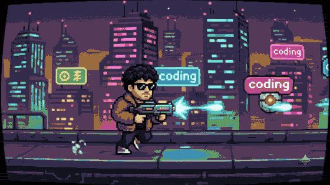

# Abhinav Pangaria

**I build resilient systems, from idea to production.**

Full-stack engineer across backend, infrastructure and the product on top. 
Previously JP Morgan Chase. Stellar SCF grantee.

[Portfolio](https://abhinavpangaria.pages.dev) &nbsp;·&nbsp; [Writing](https://dev.to/abhinav_pangaria) &nbsp;·&nbsp; [LinkedIn](https://linkedin.com/in/abhinavpangaria) &nbsp;·&nbsp; [X](https://x.com/abhinavpangaria) &nbsp;·&nbsp; [Email](mailto:abhinavpangaria2003@gmail.com)

 

I build things end to end: the idea, the system underneath it, and the part people actually touch.

The subject keeps changing. So far it has been developer tools, payments, privacy, language learning and research, sometimes alone and sometimes inside a large bank. The habit stays the same: understand the problem properly, build the smallest thing that really solves it, then keep at it until it holds up with real people using it.

 

## Recent work

| | Project | What it is | The number that matters |
|---|---|---|---|
| 01 | **[Sieve](https://github.com/18Abhinav07/A-Game-Of-Vectors)** | A vector search engine written from scratch: a billion vectors, searched on one laptop. Rust · [site](https://18abhinav07.github.io/A-Game-Of-Vectors/) | 1B vectors at **420 QPS**, R@10 0.906, **225 MB** of RAM |
| 02 | **[Voluntas](https://github.com/18Abhinav07/Voluntas-Challenge)** | An order-book collector for Kalshi and Polymarket that keeps every book exact. Rust · [writeup](https://18abhinav07.github.io/Voluntas-Challenge/) | **118.2M** snapshots replayed, **0** mismatches |
| 03 | **[Prefill and the Frame](https://github.com/18Abhinav07/DiggingOnDart)** | Local inference vs. the browser compositor: why GPU-heavy pages stutter while a model reads. Python · llama.cpp | **64%** dropped frames at batch 512, **1.3%** at batch 64 |
| 04 | **[Loom](https://github.com/18Abhinav07/Loom)** | A shared, live world model for parallel coding agents, kept in one graph. TypeScript · [post](https://dev.to/abhinav_pangaria/stale-memory-stale-execution-and-how-loom-tackles-stalebench-f2i) | Merges passing: **0/36** without it, **24/36** with it |
| 05 | **[Guardian Kane](https://github.com/18Abhinav07/adventures-with-kane)** | The loop that makes an agent's "done" something it has to prove, not just say. Node.js · Claude Code | **460+** unit tests, 3-strike escalation to a human |
| 06 | **[AgentOps](https://github.com/AgenticOperations/AOPS-PMOA)** | The organizational control plane for agents that hold money. TypeScript · [deck](https://canva.link/ja7l3zsexb11suy) | **5** agents on **2** chains, fail-closed policy |
| 07 | **[Zidd](https://zidd.onrender.com)** | An AI English coach for learners in India, from Class 2 chapters to the interview room. FastAPI · LangGraph | **47** NCERT chapters, **2,330** backend tests |

 

## Watch it run

<table>
<tr>
<td width="33%" valign="top" align="center">

<b>Loom</b> · StaleBench on Django

</td>
<td width="33%" valign="top" align="center">

<b>Guardian Kane</b> · full system demo

</td>
<td width="33%" valign="top" align="center">

<b>AgentOps</b> · demo

</td>
</tr>
<tr>
<td width="33%" valign="top" align="center">

<b>PayZoll</b> · Build Better hackathon

</td>
<td width="33%" valign="top" align="center">

<b>VEIL</b> · Stellar ZK Hacks build

</td>
<td width="33%" valign="top" align="center">

<b>Pods</b> · demo

</td>
</tr>
</table>

 

## Earlier

- **[PayZoll](https://payzoll.in)** · cross-border payroll and treasury on Stellar. Ex co-founder and lead architect.
- **[Tesseract](https://tesseractprotocol.xyz)** and **VEIL** · privacy as a wallet primitive on Stellar.
- **[Kredio](https://kredio-gamma.vercel.app)** · on-chain credit on Polkadot. [Walkthrough](https://www.youtube.com/watch?v=zNR5cX0gdCA)
- **[OpenAssets](https://github.com/TheOpenAssets)** · an RWA gateway on Mantle. [Demo](https://www.youtube.com/watch?v=RYDPzdRAqPg)
- **Pods** · NIM-backed accountability for small groups.

 

## Tools I reach for

 

## Activity

<picture>
  <source media="(prefers-color-scheme: dark)" srcset="https://raw.githubusercontent.com/18Abhinav07/18Abhinav07/output/github-contribution-grid-snake-dark.svg" />
  <source media="(prefers-color-scheme: light)" srcset="https://raw.githubusercontent.com/18Abhinav07/18Abhinav07/output/github-contribution-grid-snake.svg" />
  
</picture>

<b>Certificates</b> &nbsp;·&nbsp; DeepLearning.AI · Harvard CS50 · Google · Coursera

 

| | |
|---|---|
| [Deep Learning Specialization](Certificates/Deep_Learning_specialization.pdf) | [Machine Learning Specialization](Certificates/Machine_Larning_Specialisation.pdf) |
| [TensorFlow Developer](Certificates/TF_developer.pdf) | [Generative AI](Certificates/Generative_AI.pdf) |
| [Neural Networks & Deep Learning](Certificates/Neural_Networks_and_Deep_Learning.pdf) | [Convolutional Neural Networks](Certificates/CNN.pdf) |
| [Sequence Models](Certificates/Sequence_models.pdf) | [NLP with TensorFlow](Certificates/NLP_TF.pdf) |
| [Supervised ML](Certificates/Supervised_ML.pdf) | [Unsupervised Learning](Certificates/Unsupervised_Learning.pdf) |
| [Advanced Learning Algorithms](Certificates/Advanced_Learning_Algorithm.pdf) | [Hyperparameter Tuning](Certificates/Improving_Hyperparameters.pdf) |
| [Structuring ML Projects](Certificates/Structuring_ML_Project.pdf) | [CS50 · AI with Python](Certificates/CS50AI.pdf) |
| [CS50 · Python](Certificates/CS50P.pdf) | [CS50 · Web](Certificates/CS50WEB.pdf) |
| [CS50 · SQL](Certificates/CS50_SQL.pdf) | [CS50 · Cybersecurity](Certificates/CS50Cybersecurity.pdf) |
| [Google Data Analytics](Certificates/Data_Analytics.pdf) | [Full-Stack Development](Certificates/FullStack.pdf) |
| [Django](Certificates/Django.pdf) | [JavaScript](Certificates/Javascript.pdf) |
| [API Development](Certificates/API.pdf) | [R Programming](Certificates/R_programming.pdf) |

 

**Open to roles, or just say hi.** &nbsp;[abhinavpangaria2003@gmail.com](mailto:abhinavpangaria2003@gmail.com)

